# THIẾT KẾ MÔ HÌNH THỰC THỂ LIÊN KẾT (ERD - ENTITY RELATIONSHIP DIAGRAM)
## DỰ ÁN: ỨNG DỤNG WEB QUẢN LÝ CHI TIÊU CÁ NHÂN & NHÓM

---

### 1. SƠ ĐỒ THỰC THỂ LIÊN KẾT (MERMAID ERD)

```mermaid
erDiagram
    PROFILES ||--o{ WALLETS : "creates"
    PROFILES ||--o{ WALLET_MEMBERS : "belongs_to"
    PROFILES ||--o{ TRANSACTIONS : "creates"
    PROFILES ||--o{ WALLET_INVITATIONS : "invites / receives"
    PROFILES ||--o| USER_PREFERENCES : "configures"
    PROFILES ||--o{ AUDIT_LOGS : "performs"
    PROFILES ||--o{ SYNC_OPERATIONS : "submits"

    WALLETS ||--o{ WALLET_MEMBERS : "has"
    WALLETS ||--o{ TRANSACTIONS : "contains"
    WALLETS ||--o{ WALLET_INVITATIONS : "issues"
    WALLETS ||--o{ WALLET_TRANSFERS : "source_for"
    WALLETS ||--o{ WALLET_TRANSFERS : "destination_for"

    CATEGORIES ||--o{ TRANSACTIONS : "categorizes"
    WALLETS ||--o{ CATEGORIES : "custom_categories"

    TRANSACTIONS ||--o| WALLET_TRANSFERS : "source_tx"
    TRANSACTIONS ||--o| WALLET_TRANSFERS : "destination_tx"

    PROFILES {
        uuid id PK "References auth.users"
        varchar email UK
        varchar full_name
        varchar avatar_url
        boolean is_system_admin
        boolean is_active
        timestamptz created_at
        timestamptz updated_at
    }

    WALLETS {
        uuid id PK
        varchar name
        text description
        varchar type "PERSONAL | SHARED"
        varchar currency "VND"
        numeric initial_balance
        boolean is_archived
        uuid created_by FK
        integer version
        timestamptz created_at
        timestamptz updated_at
    }

    WALLET_MEMBERS {
        uuid id PK
        uuid wallet_id FK
        uuid user_id FK
        varchar role "OWNER | EDITOR | VIEWER"
        timestamptz joined_at
        timestamptz updated_at
    }

    WALLET_INVITATIONS {
        uuid id PK
        uuid wallet_id FK
        varchar invitee_email
        uuid invited_by FK
        varchar role "EDITOR | VIEWER"
        varchar status "PENDING | ACCEPTED | REJECTED | EXPIRED"
        varchar token UK
        timestamptz expires_at
        timestamptz created_at
    }

    CATEGORIES {
        uuid id PK
        uuid wallet_id FK "NULL for system-wide default categories"
        varchar name
        varchar type "INCOME | EXPENSE | BOTH"
        varchar icon
        varchar color
        boolean is_default
        boolean is_active
        timestamptz created_at
        timestamptz updated_at
    }

    TRANSACTIONS {
        uuid id PK
        uuid wallet_id FK
        uuid category_id FK
        varchar type "INCOME | EXPENSE | ADJUSTMENT"
        numeric amount "amount > 0"
        timestamptz transaction_date
        varchar description
        text notes
        uuid created_by FK
        boolean is_deleted "Soft delete flag"
        timestamptz deleted_at
        uuid deleted_by FK
        integer version "Optimistic Concurrency Control"
        varchar idempotency_key UK "Client-generated UUID/Key"
        timestamptz created_at
        timestamptz updated_at
    }

    WALLET_TRANSFERS {
        uuid id PK
        uuid source_wallet_id FK
        uuid destination_wallet_id FK
        numeric amount
        timestamptz transfer_date
        varchar description
        uuid source_transaction_id FK
        uuid destination_transaction_id FK
        uuid created_by FK
        timestamptz created_at
    }

    USER_PREFERENCES {
        uuid id PK
        uuid user_id FK, UK
        varchar default_currency
        uuid default_wallet_id FK
        varchar theme "LIGHT | DARK | SYSTEM"
        boolean enable_offline_notifications
        timestamptz updated_at
    }

    SYNC_OPERATIONS {
        uuid id PK
        uuid user_id FK
        varchar device_id
        varchar client_operation_id UK
        varchar entity_name "TRANSACTION | WALLET | CATEGORY"
        uuid entity_id
        varchar operation_type "CREATE | UPDATE | DELETE"
        varchar status "SUCCESS | CONFLICT | FAILED"
        text error_message
        timestamptz processed_at
    }

    AUDIT_LOGS {
        uuid id PK
        uuid user_id FK
        varchar action "CREATE | UPDATE | DELETE | ROLE_CHANGE | AUTH"
        varchar entity_name
        uuid entity_id
        jsonb old_values
        jsonb new_values
        varchar ip_address
        text user_agent
        timestamptz created_at
    }
```

---

### 2. MÔ TẢ QUAN HỆ & RÀNG BUỘC TOÀN VẸN (CARDINALITY & CONSTRAINTS)

1. **`PROFILES` $\leftrightarrow$ `WALLETS`**:
   - Một người dùng có thể tạo nhiều quỹ (`1 - N`).
   - Người tạo quỹ tự động được thêm vào bảng `WALLET_MEMBERS` với vai trò `OWNER`.

2. **`WALLETS` $\leftrightarrow$ `WALLET_MEMBERS` $\leftrightarrow$ `PROFILES`**:
   - Quan hệ nhiều - nhiều (`M - N`) giữa người dùng và quỹ thông qua bảng trung gian `WALLET_MEMBERS`.
   - Ràng buộc: `UNIQUE(wallet_id, user_id)` đảm bảo mỗi người dùng chỉ có một vai trò duy nhất trong một quỹ tại một thời điểm.

3. **`WALLETS` $\leftrightarrow$ `TRANSACTIONS`**:
   - Một quỹ chứa nhiều giao dịch (`1 - N`).
   - Giao dịch luôn thuộc về một quỹ xác định (`wallet_id NOT NULL`).

4. **`CATEGORIES` $\leftrightarrow$ `TRANSACTIONS`**:
   - Một danh mục chứa nhiều giao dịch (`1 - N`).
   - Nếu `wallet_id IS NULL`, đó là danh mục hệ thống (dùng chung cho mọi quỹ). Nếu `wallet_id` có giá trị, đó là danh mục riêng do quỹ đó tạo ra.

5. **`WALLET_TRANSFERS` $\leftrightarrow$ `TRANSACTIONS` & `WALLETS`**:
   - Chuyển tiền từ Quỹ $A$ (`source_wallet_id`) sang Quỹ $B$ (`destination_wallet_id`).
   - Tự động tạo 2 giao dịch song hành: `source_transaction_id` (trừ tiền) và `destination_transaction_id` (cộng tiền).
   - Ràng buộc: `source_wallet_id <> destination_wallet_id`.

6. **`SYNC_OPERATIONS`**:
   - Lưu vết xử lý đồng bộ từ các thiết bị offline của người dùng.
   - `client_operation_id` (UUID tạo từ client) có ràng buộc `UNIQUE` đảm bảo mỗi tác vụ từ thiết bị offline chỉ được thi hành đúng một lần (Idempotency).
