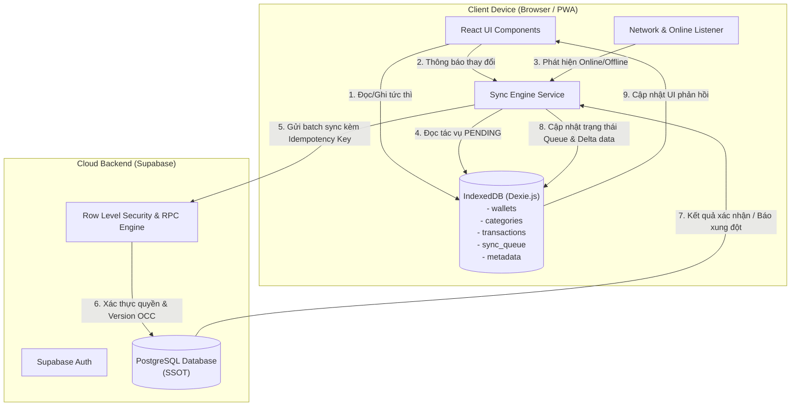

# THIẾT KẾ KIẾN TRÚC OFFLINE & ĐỒNG BỘ HAI CHIỀU (OFFLINE-FIRST & SYNC ENGINE)
## DỰ ÁN: ỨNG DỤNG WEB QUẢN LÝ CHI TIÊU CÁ NHÂN & NHÓM

---

### 1. NGUYÊN TẮC CỐT LÕI (CORE PRINCIPLES)
1. **PostgreSQL/Supabase là Nguồn Chân Lý Duy Nhất (Single Source of Truth - SSOT)**:
   - Dữ liệu trên server là chuẩn mực cao nhất.
   - IndexedDB trên từng thiết bị chỉ là bản sao làm việc cục bộ (Local Working Replica).
   - Tuyệt đối không bao giờ lấy số dư cục bộ rồi ghi đè số dư máy chủ.
2. **Trải nghiệm tức thì (Optimistic UI)**:
   - Thao tác của người dùng (tạo/sửa/xóa giao dịch) phản hồi tức thì lên UI và ghi vào IndexedDB.
   - Thao tác được đóng gói thành tác vụ ghi vào hàng đợi đồng bộ (`Sync Queue`).
3. **Độc lập thiết bị (Device Independence)**:
   - Nhiều thiết bị offline độc lập tạo giao dịch khác nhau đều được bảo toàn nguyên vẹn nhờ mã định danh toàn cầu UUID v4 sinh tại client.
4. **An toàn bảo mật (Security Validation on Sync)**:
   - Khi đồng bộ lại, server kiểm tra lại quyền thực tế tại thời điểm đồng bộ. Nếu người dùng đã bị thu hồi quyền trong thời gian offline, thao tác đồng bộ sẽ bị từ chối an toàn.

---

### 2. KIẾN TRÚC TỔNG THỂ (HIGH-LEVEL ARCHITECTURE)



---

### 3. THIẾT KẾ CƠ SỞ DỮ LIỆU CỤC BỘ INDEXEDDB (DEXIE.JS SCHEMA)

```typescript
import Dexie, { Table } from 'dexie';

export interface LocalWallet {
  id: string; // UUID
  name: string;
  description?: string;
  type: 'PERSONAL' | 'SHARED';
  currency: string;
  initial_balance: number;
  is_archived: boolean;
  created_by: string;
  version: number;
  updated_at: string;
}

export interface LocalCategory {
  id: string; // UUID
  wallet_id?: string | null;
  name: string;
  type: 'INCOME' | 'EXPENSE' | 'BOTH';
  icon?: string;
  color?: string;
  is_default: boolean;
  is_active: boolean;
  updated_at: string;
}

export interface LocalTransaction {
  id: string; // UUID v4 sinh tại client
  wallet_id: string;
  category_id: string;
  type: 'INCOME' | 'EXPENSE' | 'ADJUSTMENT';
  amount: number;
  transaction_date: string;
  description: string;
  notes?: string;
  created_by: string;
  is_deleted: boolean;
  deleted_at?: string | null;
  version: number;
  idempotency_key: string;
  sync_status: 'SYNCED' | 'LOCAL_ONLY' | 'PENDING_UPDATE' | 'PENDING_DELETE';
  created_at: string;
  updated_at: string;
}

export interface SyncQueueItem {
  queue_id?: number; // Auto-increment key
  id: string; // Client operation UUID
  entity_name: 'TRANSACTION' | 'WALLET' | 'CATEGORY';
  entity_id: string;
  operation: 'CREATE' | 'UPDATE' | 'DELETE';
  payload: any;
  base_version: number; // Phiên bản lúc client đọc trước khi sửa
  created_at: string;
  attempts: number;
  status: 'PENDING' | 'SYNCING' | 'SUCCESS' | 'CONFLICT' | 'FAILED';
  error_message?: string;
}

export interface AppMetadata {
  key: string;
  value: any;
}

export class ExpenseAppDatabase extends Dexie {
  wallets!: Table<LocalWallet, string>;
  categories!: Table<LocalCategory, string>;
  transactions!: Table<LocalTransaction, string>;
  sync_queue!: Table<SyncQueueItem, number>;
  metadata!: Table<AppMetadata, string>;

  constructor() {
    super('ExpenseAppLocalDB');
    this.version(1).stores({
      wallets: 'id, type, is_archived, updated_at',
      categories: 'id, wallet_id, type, is_active',
      transactions: 'id, wallet_id, category_id, type, transaction_date, is_deleted, sync_status, idempotency_key, updated_at',
      sync_queue: '++queue_id, id, entity_name, entity_id, operation, status, created_at',
      metadata: 'key'
    });
  }
}
```

---

### 4. QUY TRÌNH HOẠT ĐỘNG KHI OFFLINE & KHI ONLINE TRỞ LẠI

#### 4.1. Khi Offline
1. Người dùng thực hiện thao tác (Thêm / Sửa / Xóa giao dịch).
2. Hệ thống:
   - Sinh UUID v4 cho giao dịch mới.
   - Ghi trực tiếp vào bảng `transactions` trong IndexedDB với `sync_status = 'LOCAL_ONLY'`.
   - Tạo bản ghi trong `sync_queue` với `status = 'PENDING'`.
3. Giao diện:
   - Phản hồi ngay lập tức (hiển thị giao dịch trong danh sách, cập nhật số dư hiển thị tức thời).
   - Thanh trạng thái hiển thị:
     - Badge màu vàng: *"3 thao tác chưa đồng bộ"*.
     - Thời điểm đồng bộ gần nhất: *"Lần đồng bộ cuối: 15 phút trước"*.

#### 4.2. Khi Online trở lại
1. Listener `window.addEventListener('online')` hoặc Heartbeat phát hiện mạng kết nối lại.
2. `Sync Engine` được kích hoạt theo các bước:
   - **Bước A - Kiểm tra hàng đợi**: Lấy danh sách các tác vụ có `status = 'PENDING'` theo thứ tự FIFO (First-In, First-Out).
   - **Bước B - Gửi đồng bộ lên RPC `sync_batch_transactions`**:
     - Gửi mảng các tác vụ kèm `idempotency_key`, `entity_id`, `operation`, `payload`, `base_version`.
   - **Bước C - Xử lý phía Server**:
     - Kiểm tra quyền hiện tại của User (`auth.uid()`) đối với Quỹ mục tiêu. Nếu người dùng bị xóa khỏi quỹ $\rightarrow$ Trả về mã lỗi `PERMISSION_REVOKED`.
     - Kiểm tra `idempotency_key`: Nếu giao dịch đã tồn tại trên server $\rightarrow$ Coi như đã xử lý thành công (tránh tạo trùng).
     - Kiểm tra `version` (Optimistic Concurrency Control):
       - Nếu `operation = 'UPDATE'` và `current_server_version > base_version`: Phát hiện xung đột $\rightarrow$ Trả về mã `CONFLICT` kèm dữ liệu máy chủ.
       - Nếu hợp lệ: Thực thi `INSERT / UPDATE / SOFT DELETE`, tăng `version = version + 1`, ghi log vào `sync_operations` và `audit_logs`.
   - **Bước D - Cập nhật cục bộ sau khi có phản hồi từ Server**:
     - Thao tác thành công: Xóa khỏi `sync_queue`, cập nhật `sync_status = 'SYNCED'` trong IndexedDB.
     - Thao tác bị lỗi quyền (`PERMISSION_REVOKED`): Đánh dấu `status = 'FAILED'`, hiển thị cảnh báo cho người dùng: *"Bạn không còn quyền trên quỹ này. Giao dịch cục bộ được lưu để bạn sao chép sang quỹ khác"*.
     - Thao tác xung đột (`CONFLICT`): Chuyển trạng thái `status = 'CONFLICT'`, mở modal giải quyết xung đột.
   - **Bước E - Kéo dữ liệu mới (Delta Fetching)**:
     - Gửi yêu cầu lấy toàn bộ bản ghi thay đổi từ server có `updated_at > last_synced_at`.
     - Cập nhật đè vào IndexedDB để đồng bộ các thay đổi từ thiết bị khác.
     - Cập nhật `metadata.last_synced_at = now()`.

---

### 5. CHIẾN LƯỢC XỬ LÝ XUNG ĐỘT (CONFLICT RESOLUTION MATRIX)

| Tình huống xung đột | Nguyên nhân | Chiến lược xử lý tự động & tương tác người dùng |
|---|---|---|
| **2 thiết bị tạo 2 giao dịch khác nhau** | Thiết bị A tạo chi phí ăn trưa, Thiết bị B tạo chi phí xăng xe khi cùng offline. | **Không xung đột**. Hai giao dịch có 2 UUID khác nhau, cả hai đều được lưu trọn vẹn lên Server và đồng bộ về cả hai máy. |
| **2 thiết bị cùng sửa 1 giao dịch** | Thiết bị A sửa số tiền thành 200k, Thiết bị B sửa ghi chú. | **Phát hiện qua `version`**: Server giữ bản ghi của thiết bị đồng bộ trước. Thiết bị sau nhận cảnh báo xung đột và cung cấp 3 lựa chọn cho người dùng: <br>1. *Giữ dữ liệu máy chủ* (Server wins).<br>2. *Ghi đè bằng dữ liệu này* (Client wins - ép tăng version).<br>3. *Lưu thành một giao dịch mới* (Fork into new transaction). |
| **Một thiết bị xóa, một thiết bị sửa** | Thiết bị A xóa giao dịch, Thiết bị B cập nhật nội dung khi offline. | **Ưu tiên bảo vệ toàn vẹn**: Server từ chối ghi đè lên bản ghi đã xóa mềm. Báo cho người dùng thiết bị B: *"Giao dịch này đã bị xóa bởi thành viên khác. Bạn có muốn khôi phục hoặc tạo giao dịch mới?"*. |
| **Thu hồi quyền khi đang offline** | User A bị chủ quỹ đuổi khỏi quỹ chung trong lúc User A đang offline. | **Từ chối an toàn tại Server**: Server RLS/RPC từ chối mọi thao tác ghi. Sync Queue đánh dấu `FAILED`. Bản ghi offline không thể lên Server nhưng được giữ lại cục bộ để người dùng không bị mất dữ liệu đã nhập. |
